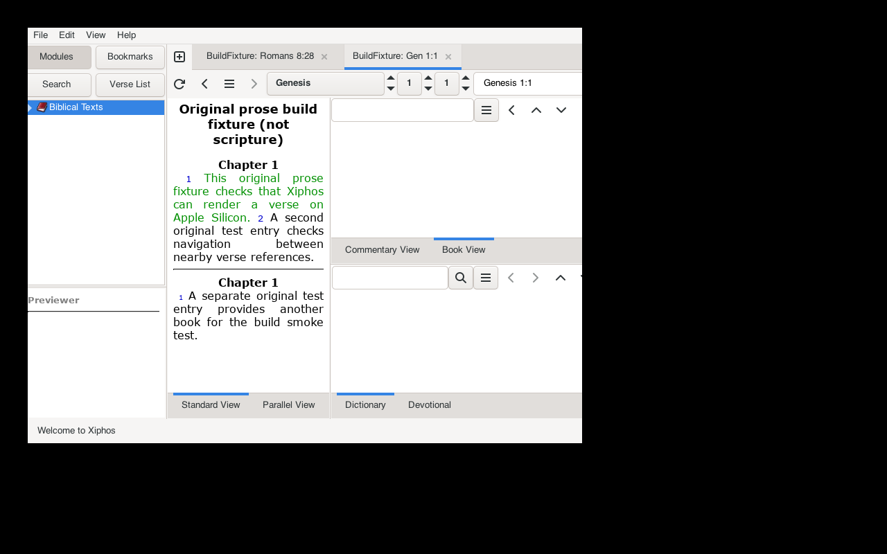

# macOS build results and issue record

Initial build recorded on 2026-10-20; workflow follow-up recorded on 2026-10-21.
Upstream base: `52302cb051d17e2bbe6846be52a942fb2490f75a`.
Environment: arm64 macOS 27.0.1 (26A434), Apple Clang 21.0.0, Xcode 27.0,
CMake 4.4.0, MacPorts 2.12.7.

## Actual outcomes

| Check | Result |
|---|---|
| MacPorts installation | Official installer checksum matched; trusted Apple signature and notarization verified |
| Ports-list synchronization | Initial rsync stalled; official signed HTTPS snapshot worked |
| GTK3/WebKitGTK | arm64 X11 binary packages installed: GTK3 3.24.52, WebKitGTK 2.52.4 |
| SWORD 1.9.0 | Binary unavailable; source build passed after local C++17 recipe correction for ICU 78.3 |
| BibleSync 2.2.0 | Wrapped configure, compile, link and local install passed against MacPorts |
| Full GTK app | Configure, compile, link and install passed; executable verified as arm64 |
| Dependency linkage | Installed executable links MacPorts libraries and local BibleSync; install RPATH verified |
| Compatibility tests | Initial 2/2 passed; follow-up 4/4 passed against MacPorts |
| Shortcut values | All 61 replacement GDK key values matched original X11 values in a compiled check |
| Empty-profile startup | GTK welcome and Module Manager windows appeared on Xvfb |
| SWORD/WebKit rendering | Original-prose fixture rendered; `sword://BuildFixture/Genesis1:1` opened a verse tab |
| Runtime observation | App remained running after 12 seconds on the test display |
| Normal desktop launch | User confirmed on 2026-10-21 that it opened and worked; owner-reported, not an automated UI check |
| D-Bus navigation | Actual app returned Gen 1:2, John 1:1, then Gen 1:1 after navigation requests |
| SWORD search | Original-prose fixture returned expected phrase-search counts of 1, 3, and 0 |
| Note storage | UTF-8 RawFiles note survived close and reopen; engine test, not GTK editor test |
| Startup critical regression | Original binary failed with a fatal invalid-tree-iterator critical; fixed build passed with fatal GTK criticals enabled |

The fixture was authored for the test and is not scripture or copied module
content. No installed user Bible modules or preferences were changed. Generated
profiles, raw machine-path-bearing logs, installed dependencies and executables
are excluded from this repository. Evidence images show only the isolated test.

## Resolved build and launch issues

1. **Linux assumptions:** desktop-file/appstream validators and metadata targets
   were treated as Unix-wide requirements. macOS now skips those Linux targets.
2. **ELF flags:** `-rdynamic`, `-Wl,-z,muldefs`, and linker strip assumptions are
   excluded on macOS. Linux and Windows paths remain available.
3. **UUID/gettext:** macOS UUID lives in libSystem. BibleSync needed explicit
   libintl linkage, matching the historical failure discussed in issue #760.
4. **SWORD discovery:** Homebrew supplied no `sword.pc`; unrelated `/usr/local`
   metadata selected a static library with missing compression dependencies.
   macOS discovery now uses the selected prefix's actual headers and library.
5. **ICU language level:** both the SWORD dependency recipe and app compilation
   needed C++17 with ICU 78. The local recipe patch is recorded separately.
6. **BibleSync include layout:** Xiphos uses both flat and directory-qualified
   headers. Its finder now exposes the necessary include roots for a local prefix.
7. **Installed dylib loading:** the first installed app had no BibleSync RPATH.
   External-prefix install search paths are now retained.
8. **Speech and images:** Linux Speech Dispatcher is not linked on macOS;
   AVFoundation implements the existing speak/cancel interface. Images use `open`.
9. **Darwin WebKit headers:** `BUILDING_GTK__` selects the GTK availability path.
10. **Version discovery:** shallow clones now fall back to the checked-in version
    instead of treating a failed `git describe` as success.
11. **Session setup:** normal MacPorts D-Bus expects launchd's session socket.
    The controlled launch used a private session configuration without changing
    system policy. Normal interactive login setup remains separate.

## Remaining issues and limits

* The tree-store startup warnings were fixed on 2026-10-21 by removing unused
  child-row lookups in the language-folder callbacks. Empty categories can have
  placeholder parent iterators; no lookup is needed when their language list is
  empty. The original binary aborted with `G_DEBUG=fatal-criticals`; the fixed
  build passed startup and navigation under the same setting. Initial
  empty-profile dialog sizing/button-box warnings remain a separate issue.
* An inherited `C.UTF-8` locale caused a warning; the final test used the available
  `en_US.UTF-8` locale. Fontconfig reported writable-cache warnings on one run.
* The upstream build emits malformed `PkgConfig::WK` preprocessor-definition
  warnings, as well as other deprecation warnings; the build still succeeds.
* Rendering/navigation evidence is a small fixture check, not feature parity.
  SWORD phrase search and RawFiles persistence were tested independently of the
  app's dialogs. Interactive search, notes editing/save dialogs, module downloads,
  BibleSync multicast, audio playback/cancellation, images, printing, help and
  complete localization remain unverified. Desktop automation timed out for X11,
  so no interactive editor test is claimed.
* No Linux/Windows regression build or macOS Quartz build was run.
* No standalone `.app`, bundled dylibs, signing or notarization. TGZ packaging is
  only a developer prefix archive and depends on installed libraries/resources.
* Inherited hosted builds are manual-only in this repository. No hosted build
  has been run or is claimed to validate macOS.

Sources: [upstream issue #760](https://github.com/crosswire/xiphos/issues/760),
[MacPorts WebKitGTK recipe](https://github.com/macports/macports-ports/blob/master/www/webkit2-gtk/Portfile),
[MacPorts SWORD recipe](https://github.com/macports/macports-ports/blob/master/textproc/sword/Portfile),
[Homebrew WebKitGTK recipe](https://github.com/Homebrew/homebrew-core/blob/main/Formula/w/webkitgtk.rb).

## Follow-up test reproduction

The optional full-app test uses an already-running **unused test display**,
creates a marked disposable profile, starts its own private D-Bus daemon, imports
original-prose fixture data, and checks three navigation round trips. It rejects
an existing non-test profile. It stops only the child app and bus it created.
The user's existing desktop app is not connected to this test bus.

The separate `sword-workflows` test exercises verse retrieval, phrase searches
and UTF-8 RawFiles note storage through the real SWORD library. It does not drive
Xiphos' notes editor or assert rich-text parity.

See the [test commands](macos.md#compatibility-tests). The regression build was
installed separately from the user's running desktop binary; that session was
left untouched. Rebuild/restart the desktop app to pick up the source fix.
